# SieveLab

> Raw web in. Clean training signal out — measured at every mesh of the sieve.

**SieveLab** is a web-scale data curation lab for LLM pretraining, with first-class Urdu and
low-resource language support. Every stage is an instrumented sieve — not a black-box filter.

Text extraction from WARC/WET/HTML → language ID → Gopher/C4 heuristics → exact + MinHash-LSH
dedup → FineWeb-Edu-style educational classifier → PII redaction → toxicity filtering →
JSONL/Parquet export, with a manifest of counts at every stage and **precision/recall for
every filter** measured against injected ground truth.

Runs end to end on the bundled sample crawl in ~10 seconds on a laptop CPU. No API keys,
no downloads, no GPU.

```bash
pip install -e ".[all]"                       # or: pip install numpy scikit-learn pyyaml pyarrow
python scripts/run_pipeline.py                # curate the sample crawl -> outputs/default/
python scripts/prove_cleaning_helps.py        # train LMs on raw vs cleaned data
pytest                                        # 36 tests
```

---

## The problem

Training-data quality now moves model quality more than most architecture changes.
FineWeb-Edu kept about a tenth of FineWeb and matched or beat it on knowledge
benchmarks; DCLM showed a single quality classifier beats stacks of heuristics. But:

1. **Curation pipelines are rarely measured.** Papers report "removed X %", rarely the
   precision or recall of each filter.
2. **Filters are tuned on English.** Low-resource languages are hurt silently. Urdu is
   confused with Persian, Roman Urdu is invisible to standard language ID, and English
   rule thresholds over-filter Arabic-script text.

SieveLab is a compact, fully instrumented implementation of the modern recipe that makes
both visible.

## Architecture

```mermaid
flowchart LR
    W[WARC / WET / HTML / JSONL] --> X[Extract main text]
    X --> L[Language ID<br/>script + function words<br/>ur · ur_Latn · ps · sd · fa · ar ...]
    L --> H[Heuristics<br/>Gopher / C4, language-aware]
    H --> D[Dedup<br/>SHA-256 exact + MinHash LSH<br/>streaming or map-reduce]
    D --> Q[Edu classifier<br/>teacher → student, 0-5]
    Q --> P[PII<br/>email · phone · CNIC · card · IBAN · IP]
    P --> T[Toxicity<br/>sentence-level lexicon + clf]
    T --> E[(clean.jsonl / .parquet<br/>by_lang shards)]
    E --> M[manifest.json · eval.json]
```



Details: [`docs/ARCHITECTURE.md`](docs/ARCHITECTURE.md) (stage order, data contract),
[`docs/SYSTEM_DESIGN.md`](docs/SYSTEM_DESIGN.md) (Spark/Ray at Common Crawl scale, cost model).

| Module | What it implements |
|---|---|
| `sievelab/lang/` | WARC/WET reader-writer (plain + per-record gzip), boilerplate-aware HTML extractor, script + function-word language ID with Urdu/Persian/Arabic/Pashto/Sindhi disambiguation and Roman Urdu; `langdetect` and fastText backends |
| `sievelab/dedup/` | MinHash with universal hashing (datasketch-compatible), LSH banding with optimal (b, r), union-find, exact SHA-256 dedup with Arabic-letter folding, streaming and map-reduce deduplicators, multiprocessing / Ray signature workers, optional datasketch backend |
| `sievelab/quality/` | Language-aware Gopher/C4 rules; additive 0-5 educational rubric as teacher; TF-IDF char+word → ridge student; κ / F1 / MSE reports |
| `sievelab/safety/` | Regex + validator PII (Luhn, IPv4, CNIC, PK mobiles, IBAN, Urdu digits), honorific-triggered name detector (NER stub with spaCy adapter), severity-weighted en/ur/Roman-Urdu toxicity lexicon, optional classifier, retention policies |
| `sievelab/pipeline/` | YAML configs + CLI overrides, stages, manifest, ground-truth evaluation, JSONL/Parquet/per-language export |
| `sievelab/eval/` | Char-level Kneser-Ney LM, tiny char GPT (torch), 13-gram contamination check |
| `sievelab/synth/` | Deterministic 11-language crawl generator with ground truth, procedural fact generators, HTML/WARC rendering |

## Results

All numbers below are produced by the scripts in this repo on the bundled sample
(`configs/default.yaml`, keep `en` + `ur`).

### Filtering rates (manifest)

Ingested **2,707** documents (WARC + WET + HTML + JSONL, 11 languages, 1.02 M chars) → kept **678 (25.0 %)**.

| Stage | In | Out | Removed (% of stage input) | Top reasons |
|---|---:|---:|---:|---|
| Language ID | 2,707 | 1,986 | 26.6 % | hi, Roman Urdu, fr, es, fa, sd, ar, sw, ps |
| Heuristics | 1,986 | 1,514 | 23.8 % | exclamation spam, too short, repeated lines |
| Dedup | 1,514 | 1,257 | **17.0 %** | 138 near-dup, 119 exact (14 bands × 9 rows) |
| Edu classifier | 1,257 | 707 | **43.8 %** | educational score < 2.5 |
| PII | 707 | 707 | 0 % (102 docs redacted) | 38 phones, 37 CNICs, 33 cards, 33 emails, 13 IPs |
| Toxicity | 707 | 678 | 4.1 % | abusive comments |

Final language mix: 354 Urdu, 324 English. Final composition by gold type: 461 long
educational, 187 short educational, 8 news; zero spam, chat or boilerplate.

### Filter quality vs. ground truth

| Filter | Metric | In-distribution | Out-of-distribution challenge |
|---|---|---:|---:|
| Language ID | accuracy | 0.999 (documents) | **0.966** sentence-level (langdetect: 0.874) |
| Dedup | recall on injected duplicates | **0.969** | — |
| Dedup | precision (exact Jaccard ≥ τ) | **0.991** | — |
| Edu classifier | quadratic-weighted κ vs gold | **0.862** (en 0.842, ur 0.882) | — |
| Edu classifier | keep-decision P / R | 0.988 / 0.978 | — |
| Edu classifier (held-out split) | student κ vs gold / teacher κ vs gold | **0.890** / 0.882 | — |
| PII | entity recall | 1.00 | **0.64** (0 false positives on 7 negatives) |
| Toxicity (lexicon) | precision / recall | 1.00 / 1.00 | **0.40 / 0.40** |

The in-distribution numbers are optimistic by construction (the injected PII and abuse
come from the same templates the detectors target). The challenge sets
(`scripts/eval_langid.py`, `scripts/eval_safety_challenge.py`) are hand-written to be hard,
and they are what to quote.

### Does cleaning help? LM perplexity, raw vs. clean

Five training sets from the same crawl, each subsampled to the **same 333,724 characters**
(3 seeds), character 5-gram Kneser-Ney with a shared vocabulary, evaluated on 240 held-out
educational documents (en + ur) whose sentences never appear in training (13-gram
overlap ≈ 1.5 % for all conditions, from shared lesson-intro templates).

| Training data | Bits/char ↓ | Char PPL ↓ | Next-char acc ↑ | Δ PPL vs raw |
|---|---:|---:|---:|---:|
| raw | 1.552 ± 0.005 | 2.932 | 0.694 | — |
| + language ID | 1.526 ± 0.003 | 2.880 | 0.701 | −1.8 % |
| + heuristics | 1.490 ± 0.003 | 2.808 | 0.709 | −4.2 % |
| + dedup | 1.483 ± 0.006 | 2.795 | 0.707 | −4.7 % |
| **full pipeline** | **1.401** | **2.641** | **0.724** | **−9.9 %** |
| raw, *all* 1.02 M chars (3.05× more data) | 1.549 | 2.926 | — | −0.2 % |

The same comparison with a **tiny character-level GPT** (2 layers, d=64, 300 steps × 32 × 64
chars, identical compute for both runs, `--gpt-steps` to train longer):

| Training data | Bits/char ↓ | Char PPL ↓ | BPC en ↓ | BPC ur ↓ | Next-char acc ↑ |
|---|---:|---:|---:|---:|---:|
| raw | 3.741 | 13.37 | 3.734 | 3.748 | 0.289 |
| **full pipeline** | **3.369** | **10.33** | **3.382** | **3.357** | **0.328** |

Cleaned data gives **22.7 % lower perplexity** at equal compute. The model is far from
converged at this budget, so read this as "cleaner data learns faster", not as final quality.

**Repetition ablation** (why dedup matters, `experiments/repetition_ablation.py`): at a
fixed budget, 3.8× repetition raises perplexity by **15.6 %** and 15× repetition by **49.8 %**.

### Resume-style summary

> Built SieveLab, a WARC-to-Parquet pretraining-data pipeline (language ID, Gopher
> heuristics, MinHash-LSH dedup, FineWeb-Edu-style classifier, PII/toxicity) with per-stage
> precision/recall. **Dedup removed 17.0 % of documents** (recall 0.97, precision 0.99);
> **the quality filter removed a further 43.8 %** (κ = 0.86 vs gold); at an equal data budget,
> **the cleaned corpus cut LM perplexity by 9.9 %** (tiny GPT at equal compute: 22.7 % lower), and beat raw data with
> 3× more characters. Built language ID that separates Urdu, Roman Urdu, Pashto and Sindhi
> (96.6 % vs 87.4 % for langdetect, ~150× faster) and released an Urdu dataset card.

## Urdu and low-resource languages

* **Language ID that knows the region.** Urdu-only letters (ٹ ڈ ڑ ں ے ہ ھ), Pashto (ټ ډ ښ ګ),
  Sindhi (ڄ ڃ ڪ ۾), Arabic (ة ي ك) and function words separate the Arabic-script languages;
  Roman Urdu is its own class (`ur_Latn`). langdetect labels every Pashto and Sindhi test
  sentence as Persian.
* **Normalisation for dedup.** Arabic yeh/kaf folded to Urdu forms, diacritics stripped,
  so copies typed on different keyboards collide.
* **Urdu-digit PII.** `۰۳۰۰-۱۲۳۴۵۶۷` and `۳۵۲۰۲-۱۲۳۴۵۶۷-۱` are detected.
* **English rules over-filter.** Gopher's "80 % alphabetic words" rule removed **41 % of
  educational documents** (math-heavy text); SieveLab ships 0.6 (0 % removed).
* **Retention policies for scarce data.** `redact_sentences` removes abusive comments while
  keeping the article (16 Urdu documents saved in the Urdu build).
* **Dataset card:** [`docs/URDU_DATASET_CARD.md`](docs/URDU_DATASET_CARD.md). 273 documents
  (26.5 % of Urdu input), filtering rates per stage, κ = 0.88 on Urdu.

## Usage

```bash
# Curate with a config, override anything from the CLI
python scripts/run_pipeline.py --config configs/urdu.yaml
python scripts/run_pipeline.py --set dedup.threshold=0.8 --set dedup.workers=4 --set dedup.mode=mapreduce
sievelab run --config configs/strict.yaml --base-dir .      # console script after pip install -e .

# Components
python scripts/make_sample_corpus.py        # regenerate data/samples deterministically
python scripts/train_quality_clf.py         # teacher -> student, writes models/edu_quality.pkl
python scripts/eval_langid.py               # sentence-level LID benchmark (heuristic vs langdetect)
python scripts/eval_safety_challenge.py     # hand-written PII / toxicity stress test
python experiments/repetition_ablation.py
```

```python
from sievelab.dedup import NearDuplicateDeduplicator
from sievelab.lang import LanguageIdentifier
from sievelab.safety import PIIDetector, redact

LanguageIdentifier().predict("yaar kal ka match bohat zabardast tha")   # ('ur_Latn', 0.775)
res = NearDuplicateDeduplicator(threshold=0.7, mode="mapreduce").run(texts)
text = redact(s, PIIDetector().detect(s))                               # '... <PHONE> ...'
```

Each run writes `outputs/<run>/`: `clean.jsonl`, `clean.parquet`, `by_lang/*.jsonl`,
`rejected.jsonl` (every removed document with stage and reason), `manifest.json` /
`manifest.md`, and `eval.json` (precision/recall vs ground truth).

Configs: `default` (en + ur), `urdu` (Urdu only, sentence-level toxicity redaction),
`strict` (higher edu threshold, exact-Jaccard verification, map-reduce dedup, drop docs with
CNIC/card/IBAN), `multilingual` (11 languages, edu classifier off because it was not
trained on them).

## Limitations

* **Synthetic sample.** The crawl is generated (templates, procedural facts, hand-written
  sentences) so every filter can be scored. It is less diverse than the web, and the
  in-distribution metrics are optimistic. The challenge sets are small (40 + 206 items).
* **Rule-based teacher.** The 0-5 educational labels come from a keyword rubric, not an LLM.
  It favours school-science registers and would under-score poetry, journalism and religious
  scholarship.
* **Small-model proxy.** The LM evidence uses character n-gram and tiny-GPT models on
  ~0.3 M characters, evaluated on the same distribution the classifier selects for
  (educational text). It supports the FineWeb-Edu claim in miniature; it does not show that
  curation helps on every downstream distribution.
* **Lexicon toxicity** has 0.40 P/R out of distribution; **regex PII** misses unformatted
  identifiers (0.64 recall). The NER is a trigger-word stub.
* **Single-node dedup.** The map-reduce mode mirrors the Spark algorithm but runs in one
  process; only signature computation is distributed (multiprocessing / Ray).

## Next steps

1. Run on 10 real Common Crawl WET files; add URL blocklists and line-level (Dolma-style)
   paragraph dedup.
2. Replace the rule teacher with an LLM annotator (~50k docs) and distil into a multilingual
   encoder; calibrate thresholds per language by percentile on human-rated samples.
3. Train a learned multilingual toxicity classifier (the `ToxicityClassifier` hook exists)
   with Urdu and Roman-Urdu data; replace the NER stub with a real model.
4. 150M-parameter LM ablations on billions of tokens with Urdu/English benchmarks.
5. Spark job for global dedup and incremental cross-snapshot dedup (`docs/SYSTEM_DESIGN.md`).

## Repository layout

```
sievelab/      library (lang, dedup, quality, safety, pipeline, eval, synth)
scripts/        run_pipeline, train_quality_clf, prove_cleaning_helps, eval_langid, eval_safety_challenge, make_sample_corpus
experiments/    repetition ablation + results/ (all reported numbers)
configs/        default, urdu, strict, multilingual
data/samples/   sample crawl (JSONL, WARC, WET, HTML), quality training pool, held-out eval, safety challenge set
docs/           ARCHITECTURE, SYSTEM_DESIGN, BLOG_POST, URDU_DATASET_CARD
tests/          36 tests (MinHash/LSH, LID, WARC, extraction, PII, toxicity, quality, end-to-end pipeline, KN normalisation)
```

## License

MIT © 2026 Umar Hassan
