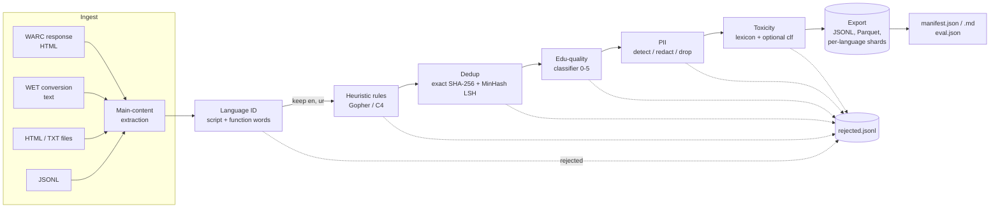

# Architecture

DataForge is a staged, auditable filter pipeline. Every stage is a pure function
`List[Document] -> (kept, rejected, info)`; the runner records counts, character
volume, rejection reasons and wall time per stage into a manifest, and writes every
rejected document with its stage and reason to `rejected.jsonl`.



## Why this order

The order follows FineWeb / Dolma: **cheap, high-recall filters first; expensive or
lossy ones last**.

| Stage | Cost / doc | Why here |
|---|---|---|
| Extraction | parse HTML | Everything downstream needs clean text. |
| Language ID | O(chars), ~0.15 ms | Removes 25-60 % of a multilingual crawl before anything expensive. |
| Heuristics | O(words) | Removes spam/boilerplate *before* dedup so templated junk does not form giant LSH buckets. |
| Dedup | MinHash: O(shingles × num_perm) | Must precede the quality classifier: otherwise duplicated content is scored (and kept) many times, and the classifier's keep-rate is inflated by repetition. |
| Quality classifier | TF-IDF + linear | Runs on the smallest possible set. |
| PII | regex, O(chars) | After quality so redaction placeholders (`<EMAIL>`) never influence the quality score; before export so nothing leaves unredacted. |
| Toxicity | lexicon, O(chars) | Last, so its retention policy (`redact_sentences`) only touches documents that will actually be shipped. |

## Modules

```
dataforge/
  document.py        Document dataclass (id, text, url, source, lang, meta)
  text_utils.py      Unicode normalisation (NFKC, Arabic-letter folding, diacritics), tokenisation
  lang/
    extract.py       HTML -> main text (tag-scoped skipping of nav/footer/cookie banners, line-level boilerplate rules)
    warc.py          WARC/WET reader + writer (plain or per-record gzip)
    langid.py        script detection + within-script disambiguation; langdetect / fastText backends
  dedup/
    minhash.py       shingling, universal-hash MinHash (datasketch-compatible)
    lsh.py           banding, optimal (b, r) selection, UnionFind
    exact.py         normalised SHA-256 exact dedup
    dedup.py         streaming and map-reduce near-dup deduplicators
    parallel.py      multiprocessing / Ray signature computation
  quality/
    heuristics.py    Gopher/C4-style rules, language-aware
    annotator.py     additive 0-5 "teacher" (stands in for the LLM annotator)
    classifier.py    TF-IDF char+word -> ridge "student"; FineWeb-Edu-style metrics
  safety/
    pii.py           regex + validators (Luhn, IPv4), Pakistani identifiers, Urdu digits
    ner.py           honorific-triggered name detector (NER stub) + spaCy adapter
    toxicity.py      severity-weighted multilingual lexicon, sentence-level scoring, optional classifier
    policy.py        retention policies (redact / drop / flag / keep; drop / redact_sentences / flag)
  pipeline/
    config.py        YAML config + dotted CLI overrides
    io.py            readers (JSONL, WARC, WET, HTML, TXT, dirs) and writers (JSONL, Parquet)
    stages.py        stage implementations
    manifest.py      per-stage accounting
    evaluation.py    join decisions with injected ground truth -> precision/recall per stage
    runner.py        orchestration + export
    cli.py           `dataforge run --config ... --set key=value`
  eval/
    ngram_lm.py      char-level interpolated Kneser-Ney LM
    tiny_gpt.py      char-level decoder-only transformer (torch)
    contamination.py 13-gram train/eval overlap
  synth/             deterministic multilingual corpus generator with ground truth
```

## Data contract

Each document flowing through the pipeline accumulates annotations under its own key:

```json
{
  "id": "doc-00042", "text": "...", "url": "...", "source": "corpus.jsonl",
  "lang": "ur", "lang_score": 0.94,
  "meta": {
    "heuristics": {"failed": [], "n_words": 187},
    "quality":    {"edu_score": 3.71, "edu_int": 4},
    "pii":        {"counts": {"PHONE": 1}, "redacted": 1},
    "toxicity":   {"score": 0.0, "hits": []}
  }
}
```

Rejected documents additionally carry `stage` and `reason`; near-duplicates carry
`dup_of`, the MinHash-estimated similarity and the exact shingle Jaccard to their
representative, so dedup decisions can be audited after the fact.

## Ground truth and evaluation

The sample corpus is synthetic *by design*: each document carries `meta._gold`
(language, document type, 0-5 quality, duplicate group, injected PII types, toxicity).
Stages never read it. `pipeline/evaluation.py` joins final decisions with these labels
so the manifest can be accompanied by per-stage precision/recall, not just removal
rates. `_gold` is stripped on export.
